# Contenedores con Docker

## Introducción

En este apartado se muestra y ejemplifica cómo se utiliza Docker desde cero, con las funcionalidades más básicas. Al terminarlo serás capaz de:

- Comprender qué es Docker.
- Instalar Docker en Ubuntu mediante la terminal.
- Utilizar los comandos `docker`.
- Descargar imágenes Docker desde Docker Hub.
- Diferenciar entre imágenes y contenedores, y consolidar los cambios de un contenedor en una nueva imagen.

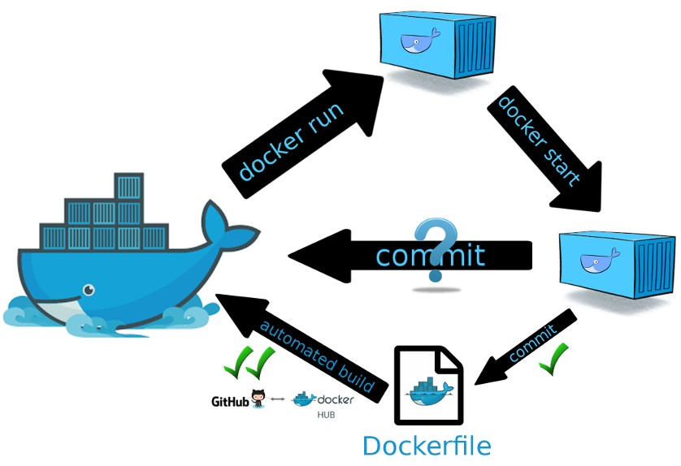{ .captura }

## ¿Qué es Docker?

**Docker** es un programa que realiza virtualización a nivel de sistema operativo, en unidades llamadas **contenedores**.

Existe un repositorio público donde se puede disponer de casi cualquier aplicación. Además, también es posible crear contenedores propios con un lenguaje muy sencillo.

A día de hoy, es la **forma más sencilla de probar cualquier tipo de software**, ya que no interfiere con el sistema operativo. Por ejemplo, si instalamos cualquier programa en Linux con `apt`, se instalarán librerías, se crearán directorios, cambiarán servicios, etc., y puede incluso que interfiera con la instalación actual. Con Docker, todo está dentro del contenedor. Se pueden tener distintas versiones corriendo simultáneamente, el mismo software corriendo múltiples veces, escalar automáticamente, actualizar y, si hay cualquier problema, volver a la versión anterior en cuestión de segundos.

Con **Docker CE** (*Community Edition*), la compañía ha decidido separar sus servicios empresariales, con servicios premium y de soporte, de la versión de la comunidad. ¿Significa eso que la versión de la comunidad tiene menos soporte o uso? No. Solo significa que es la gratuita. Como ejemplo, empresas como Amazon utilizan la Community Edition en sus servicios en la nube.

Los **contenedores de Docker** se construyen a partir de **imágenes de Docker**. Estas imágenes se obtienen de [Docker Hub](https://hub.docker.com/), un registro de imágenes gestionado por la empresa Docker. Cualquiera puede subir sus imágenes ahí, de modo que hay una gran librería de imágenes.

## Instalación de Docker en Ubuntu

La instalación se realiza desde el repositorio oficial de Docker, siguiendo el procedimiento que indica la [documentación oficial](https://docs.docker.com/engine/install/ubuntu/). Las acciones a realizar son:

**1. Actualizar la lista de paquetes existentes del sistema.**

```bash
sudo apt update
```

**2. Instalar los paquetes de requisitos previos**, que permiten descargar paquetes a través del protocolo HTTPS y verificar sus certificados.

```bash
sudo apt install ca-certificates curl
```

**3. Añadir la clave GPG** (GNU Privacy Guard) del repositorio oficial de Docker. Se crea el directorio donde APT guarda las claves de los repositorios, se descarga en él la clave de Docker y se le dan permisos de lectura:

```bash
sudo install -m 0755 -d /etc/apt/keyrings
sudo curl -fsSL https://download.docker.com/linux/ubuntu/gpg -o /etc/apt/keyrings/docker.asc
sudo chmod a+r /etc/apt/keyrings/docker.asc
```

**4. Agregar el repositorio de Docker** a las fuentes de APT:

```bash
echo "deb [arch=$(dpkg --print-architecture) signed-by=/etc/apt/keyrings/docker.asc] https://download.docker.com/linux/ubuntu $(. /etc/os-release && echo "${UBUNTU_CODENAME:-$VERSION_CODENAME}") stable" | sudo tee /etc/apt/sources.list.d/docker.list > /dev/null
```

Este comando crea el fichero `/etc/apt/sources.list.d/docker.list` con la línea del repositorio. Las partes entre `$( )` se sustituyen automáticamente por la arquitectura del equipo (por ejemplo, `amd64`) y por el nombre en clave de la versión de Ubuntu instalada (por ejemplo, `noble` en Ubuntu 24.04), de modo que el mismo comando sirve para cualquier versión. La opción `signed-by` indica a APT qué clave debe usar para verificar los paquetes de este repositorio.

**5. Actualizar de nuevo la lista de paquetes**, con el repositorio de Docker recién agregado.

```bash
sudo apt update
```

**6. Comprobar desde qué repositorio se va a instalar Docker antes de instalarlo.** Interesa que se instale desde el repositorio de Docker que se acaba de agregar, en lugar de desde el predeterminado de Ubuntu (podría dar problemas). Para ello se ejecuta:

```bash
apt-cache policy docker-ce
```

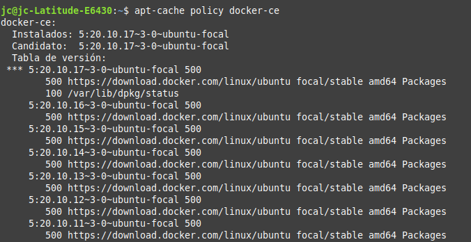{ .captura }

Se muestra la lista de versiones disponibles y el repositorio del que procede cada una. Como se puede comprobar en la figura, todas proceden de `download.docker.com`, el repositorio de Docker recién agregado, así que todo es correcto. (La captura corresponde a un Ubuntu 20.04, `focal`; en tu equipo aparecerá el nombre de tu versión.)

**7. Instalar Docker** (la versión de la comunidad, *Community Edition*) junto con sus componentes:

```bash
sudo apt install docker-ce docker-ce-cli containerd.io docker-buildx-plugin docker-compose-plugin
```

Donde:

- **`docker-ce`**: el motor de Docker (el demonio que gestiona los contenedores).
- **`docker-ce-cli`**: el cliente, es decir, el comando `docker`.
- **`containerd.io`**: el entorno de ejecución que arranca y supervisa los contenedores.
- **`docker-buildx-plugin`**: la herramienta para construir imágenes.
- **`docker-compose-plugin`**: Docker Compose, para definir aplicaciones de varios contenedores.

**8. Docker ya está instalado** y, como demonio de Ubuntu, se puede manejar mediante `systemctl` o `service`:

```bash
sudo systemctl status docker
```

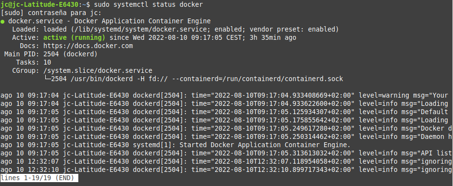{ .captura }

Una vez instalado, para probar su funcionamiento se puede ejecutar:

```bash
sudo docker run hello-world
```

!!! note
    Con este comando le pedimos a Docker que cree un contenedor con un programa llamado *hello-world* y que luego lo ejecute.

Si funciona, significa que Docker se ha instalado correctamente, que puede conectar con el servidor, descargar una imagen, ejecutarla y mostrar el resultado.

<figure markdown>
  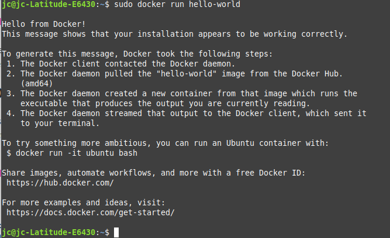{ .captura }
  <figcaption><strong>Figura 1.</strong> Prueba de funcionamiento.</figcaption>
</figure>

### Pasos post-instalación

Una vez instalado Docker y probado su funcionamiento, el siguiente paso es configurar un usuario para utilizar Docker.

Por defecto, el comando `docker`, que se comunica con el demonio Docker, está configurado para ser utilizado por **root** o por los usuarios del grupo **docker**, que se crea automáticamente durante la instalación.

Los superusuarios (*sudoers*, pertenecientes al grupo `sudo`) también pueden usar estos comandos anteponiendo `sudo`. Para no tener que usar `sudo` siempre, basta con agregar el usuario al grupo `docker`:

```bash
sudo usermod -aG docker $USER
```

Donde `$USER` es el usuario que se desea añadir al grupo (puedes escribir su nombre directamente) para que pueda utilizar los comandos Docker sin prefijarlos con `sudo` y sin ser root durante la tarea diaria.

!!! tip
    El cambio de grupo no se aplica hasta que el usuario cierra sesión y vuelve a entrar (o ejecuta `newgrp docker`).

## Vista rápida del comando `docker`

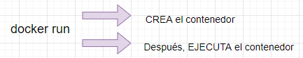{ .captura }

### 1. Listar los subcomandos disponibles

Ejecutando el comando `docker` en la consola se listan todos los subcomandos disponibles.

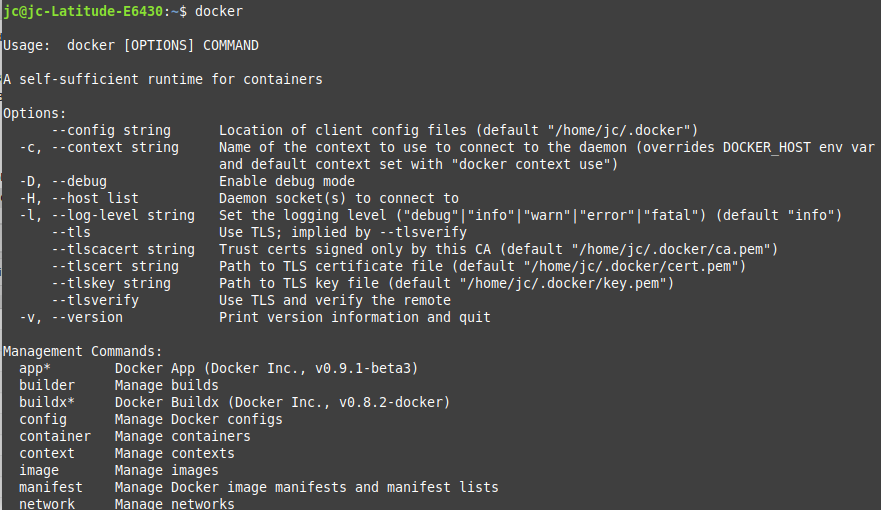{ .captura }

### 2. Listar las opciones de un subcomando

Con `docker <subcomando> --help` se consultan las opciones disponibles de un subcomando concreto.

### 3. Ejecutar un contenedor

Con el comando `docker run` primero se crea un contenedor a partir de una imagen (si no se tiene en local, se descarga de [Docker Hub](https://hub.docker.com/)) y después se ejecuta dicho contenedor. Ejemplo: `docker run hello-world`.

### 4. Buscar una imagen

Con `docker search [opciones] <término>` se busca una imagen en Docker Hub. Ejemplo: `docker search ubuntu`.

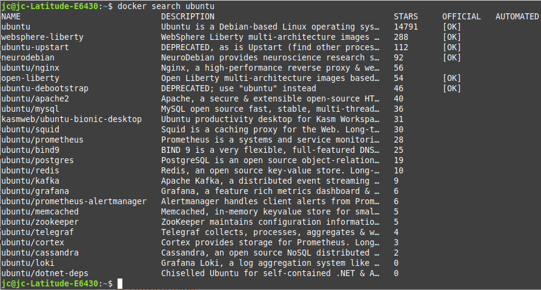{ .captura }

### 5. Descargar una imagen

Para descargar una imagen concreta se utiliza `docker pull`:

```bash
docker pull ubuntu
```

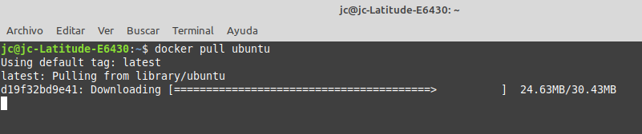{ .captura }

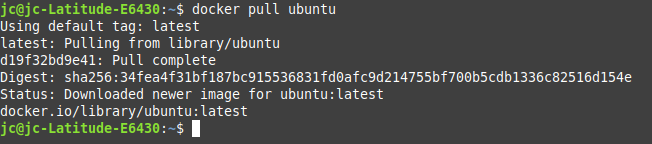{ .captura }

### 6. Consultar las imágenes descargadas

Para consultar las imágenes que hemos descargado se utiliza `docker images`:

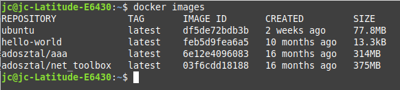{ .captura }

!!! note
    Las imágenes que descargamos de Docker Hub pueden modificarse para crear imágenes nuevas y estas, a su vez, pueden subirse a Docker Hub o a otros registros de Docker.

### 7. Ejecutar contenedores

Para ejecutar un contenedor de forma interactiva se usa `docker run -it <imagen>`. Por ejemplo:

```bash
docker run -it ubuntu
```

- **`-i`** y **`-t`** sirven para que el proceso del contenedor sea interactivo con la terminal de Linux.

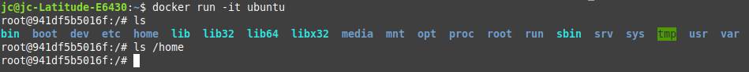{ .captura }

Como se aprecia en la figura, la **segunda línea** ya es la terminal del Ubuntu que se ejecuta en el contenedor.

Para **salir del contenedor** hay que escribir `exit`.

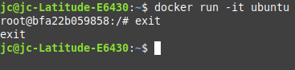{ .captura }

Si se desea dar un nombre a la instancia en lugar de que Docker le asigne uno aleatorio:

```bash
docker run -it --name ubuntu-dam ubuntu
```

Donde:

- **`--name ubuntu-dam`**: es el nombre que se le quiere dar al contenedor, en este caso `ubuntu-dam`.
- **`ubuntu`**: es el nombre de la imagen a partir de la que se crea.

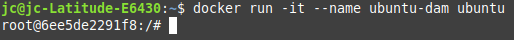{ .captura }

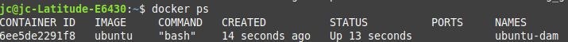{ .captura }

### 8. Consultar los contenedores en ejecución

Para consultar los contenedores que están corriendo se utiliza `docker ps`.

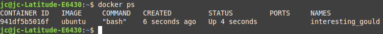{ .captura }

Para consultar todos los contenedores, tanto activos como detenidos, se utiliza `docker ps -a`.

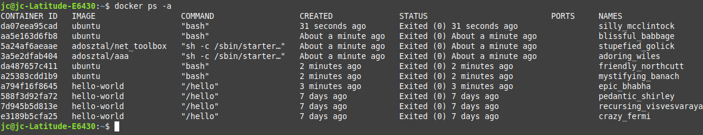{ .captura }

Por último, para consultar el último contenedor creado se utiliza `docker ps -l`.

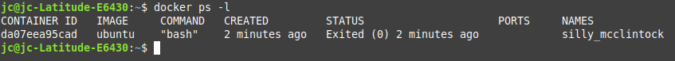{ .captura }

### 9. Iniciar un contenedor detenido

Para iniciar un contenedor detenido (no confundir con `docker run`, que crea uno nuevo):

```bash
docker start <id|nombre_contenedor>
```

### 10. Borrar un contenedor

```bash
docker rm <id|nombre_contenedor>
```

Ejemplo:

```bash
docker rm ubuntu-dam
```

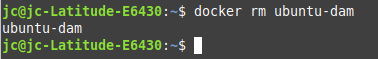{ .captura }

### 11. Borrar un contenedor por su ID

Para eliminar contenedores por su ID, primero se listan los contenedores para conocer su ID:

```bash
docker ps -a
```

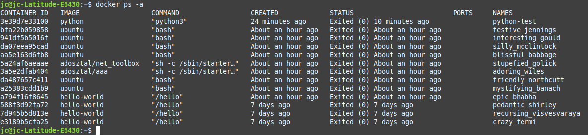{ .captura }

En este caso se elimina el contenedor con ID **3e39d7e33100**.

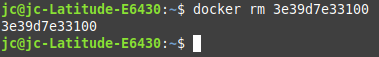{ .captura }

Si se consulta de nuevo la lista de contenedores, ya no aparece el que se acaba de borrar.

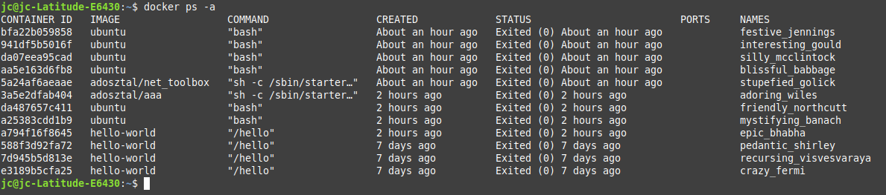{ .captura }

Se pueden borrar varios contenedores a la vez indicando sus ID separados por espacios:

```bash
docker rm a794f16f8645 588f3d92fa72 7d945b5d813e e3189b5cfa25
```

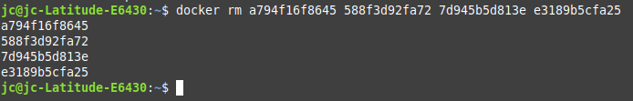{ .captura }

### 12. Borrar una imagen

Para borrar una imagen se utiliza `docker rmi` seguido de la imagen que se desea eliminar. Para conocer el ID de la imagen se puede utilizar `docker images -a`. En este ejemplo se elimina la imagen de *hello-world*:

```bash
docker rmi feb5d9fea6a5
```

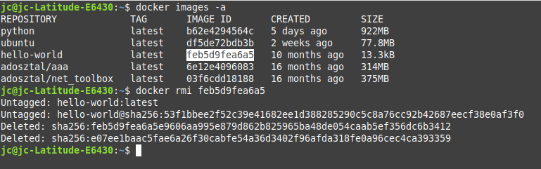{ .captura }

## Consolidar los cambios de un contenedor

Cuando se crea un contenedor con `docker run <imagen>`, se pueden modificar y eliminar archivos y hacer lo que se quiera con él. Pero todos esos cambios solo se guardan en ese contenedor, de manera que, si se hace `docker rm` para eliminarlo, se perderá todo.

Para evitarlo, se pueden consolidar los cambios en una nueva imagen de Docker, de forma que se pueda compartir fácilmente y tener siempre una copia del contenedor en el estado deseado.

!!! example "Creando un contenedor con un servidor web en una máquina virtual Ubuntu Server"

    Hay muchas imágenes en el registro público Docker Hub. Por ejemplo, podemos crear un servidor web con Apache (`httpd`):

    ```bash
    docker run -d --name my-apache-app -p 8080:80 httpd
    ```

    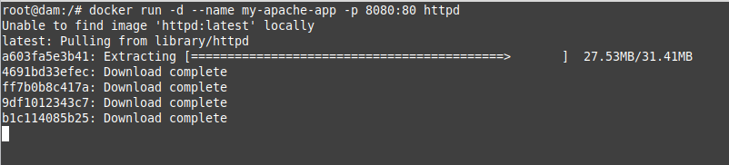{ .captura }

    El contenedor se está ejecutando y, con la opción `-p`, mapeamos un puerto del equipo donde está instalado Docker con un puerto del contenedor: si accedemos a la IP del equipo que tiene Docker (en este caso un Ubuntu Server) por el primer puerto indicado, la petición se redirige al contenedor por el segundo puerto indicado. Nunca utilizamos directamente la IP del contenedor para acceder a él.

    Para probarlo, accede desde un navegador a la IP del servidor con Docker y al puerto 8080 (en el ejemplo, `http://192.168.0.25:8080`):

    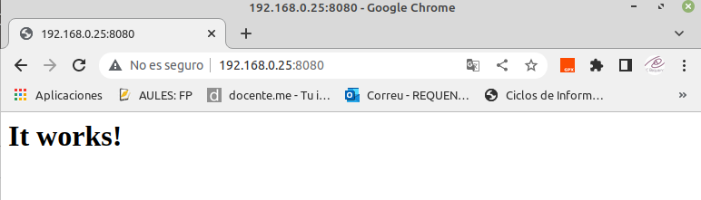{ .captura }

### Consultar el log

Para acceder al log del contenedor podemos ejecutar:

```bash
docker logs my-apache-app
```

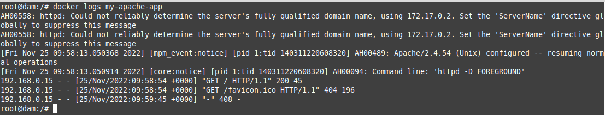{ .captura }

Con la opción `docker logs -f` seguimos visualizando los logs en tiempo real.

### Modificar el contenido del servidor web

Si **consultamos la documentación** de la imagen [httpd](https://hub.docker.com/_/httpd) en Docker Hub, vemos que el servidor web del contenedor guarda sus ficheros (directorio *DocumentRoot*) en `/usr/local/apache2/htdocs/`. Vamos a crear un nuevo fichero `index.html` en ese directorio.

Lo podemos hacer de varias formas:

**1. Accediendo de forma interactiva al contenedor** y haciendo la modificación:

```bash
docker exec -it my-apache-app bash
```

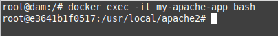{ .captura }

Ya dentro del contenedor:

```bash
cd /usr/local/apache2/htdocs/
echo "<h1>Servidor Web - Docker</h1>" > index.html
exit
```

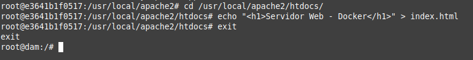{ .captura }

**2. Ejecutando directamente el comando** de creación del fichero en el contenedor:

```bash
docker exec -it my-apache-app bash -c 'echo "<h1>Servidor Web - Docker</h1>" > /usr/local/apache2/htdocs/index.html'
```

Independientemente de cómo hayamos creado el fichero, podemos volver a acceder al servidor web y comprobar que se ha modificado el contenido del `index.html`:

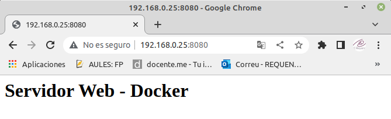{ .captura }

### Guardar los cambios en una nueva imagen

Para consolidar el contenedor modificado en una imagen nueva se utiliza `docker commit`:

```bash
docker commit my-apache-app mi-apache:v1
docker images
```

A partir de esa imagen se pueden crear nuevos contenedores que ya incluyen la web modificada:

```bash
docker run -d --name apache-copia -p 8081:80 mi-apache:v1
```

## Referencias

- [Docker Hub](https://hub.docker.com/): repositorio con gran cantidad de imágenes de contenedores ya configuradas. Además, actúa como *hosting* gratuito para alojar imágenes, tanto de forma pública como privada.
- [Cómo eliminar imágenes, contenedores y volúmenes de Docker](https://www.digitalocean.com/community/tutorials/how-to-remove-docker-images-containers-and-volumes-es)
- [Cómo crear un contenedor con Docker-MySQL y persistir la información](https://platzi.com/tutoriales/1432-docker/3268-como-crear-un-contenedor-con-docker-mysql-y-persistir-la-informacion/)
