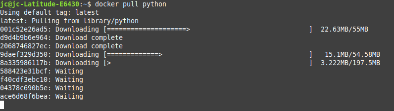
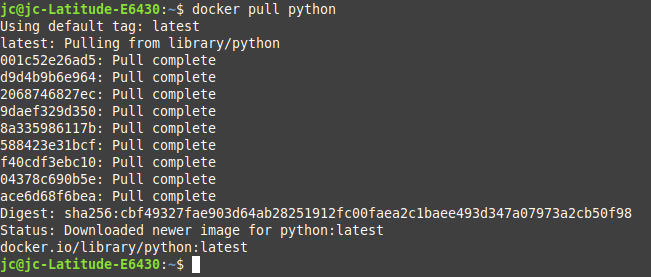
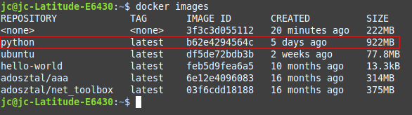
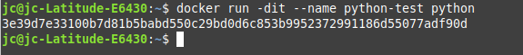
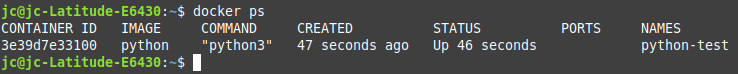
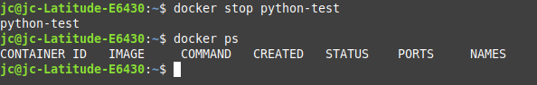
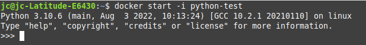
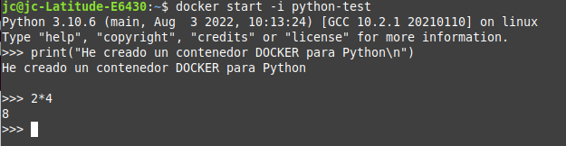

# Laboratorio: contenedor Docker de Python

## Introducción

En este laboratorio se describe el proceso de instalación de un contenedor Docker de Python y su posterior ejecución para comprobar su funcionamiento. Para ello, se accederá a Docker Hub para descargar la imagen apropiada y se ejecutará un script sencillo en este lenguaje de programación.

Tras este laboratorio serás capaz de:

- Poner en marcha un contenedor que permita ejecutar programas escritos en Python.
- Verificar que el contenedor funciona correctamente.

## Descripción del contenedor

La imagen que se va a utilizar es la siguiente: [https://hub.docker.com/_/python](https://hub.docker.com/_/python). Como indica el enlace, se trata de la **imagen Docker oficial de Python**.

El **script** que se va a ejecutar es muy sencillo: simplemente se imprime por pantalla una cadena de texto y el resultado de una operación matemática. Si todo sale bien, eso demostrará que el contenedor funciona correctamente.

## Instalación y puesta en marcha del contenedor

Mediante el comando `docker pull python` se descarga la imagen para crear el contenedor de Python. Otra posibilidad sería ejecutar directamente `docker run python` que, al no encontrar la imagen en el sistema local, la descargaría automáticamente de Docker Hub. En este laboratorio se va a utilizar la primera opción.

```bash
docker pull python
```

{ .captura }

{ .captura }

A continuación, se comprueba que la imagen se ha descargado correctamente:

```bash
docker images
```

{ .captura }

Ahora ejecutamos el comando `run` con algunos modificadores para personalizarlo (por ejemplo, ponerle un nombre para no tener que escribir el ID del contenedor cada vez):

```bash
docker run -dit --name python-test python
```

{ .captura }

Comprobamos que el contenedor está funcionando con `docker ps`:

{ .captura }

## Verificación de su comportamiento

Una vez comprobado que el contenedor de Python está creado e iniciado, vamos a utilizarlo. Para ello, en primer lugar se detiene (para luego poder arrancarlo de manera interactiva):

```bash
docker stop python-test
```

{ .captura }

A continuación, se vuelve a iniciar, esta vez de forma interactiva, con `docker start -i`. Se abrirá el intérprete de Python que se ejecuta dentro del contenedor:

```bash
docker start -i python-test
```

{ .captura }

Una vez aquí, ya se puede escribir cualquier instrucción válida en Python y debería ejecutarse sin problemas. Como ejemplo, imprimimos por pantalla una cadena de texto y luego una operación matemática sencilla:

```python
>>> print("He creado un contenedor DOCKER para Python")
He creado un contenedor DOCKER para Python
>>> 2*4
8
```

{ .captura }

## Conclusiones

Una vez estudiado este apartado y realizado el laboratorio, has adquirido la competencia de instalar Docker en Ubuntu, conoces los comandos principales de Docker y sabes descargar imágenes del repositorio Docker Hub, así como utilizarlas para crear contenedores.

Habrás podido comprobar la utilidad que esto tiene a la hora de desarrollar tus propios proyectos de software: puedes consolidar los contenedores en imágenes nuevas que otros compañeros/as podrían descargar, evitando muchos problemas con las dependencias de los proyectos, y todo ello sin necesidad de tener un sistema operativo completo funcionando para cada contenedor, como ocurre con las máquinas virtuales.

La prueba que se ha utilizado en este laboratorio es muy simple, pero suficiente para comprender el funcionamiento básico de la herramienta.
